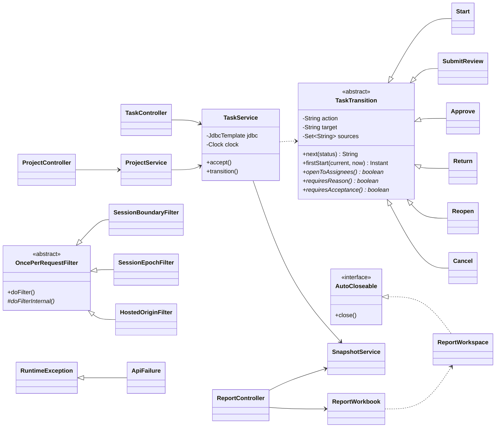
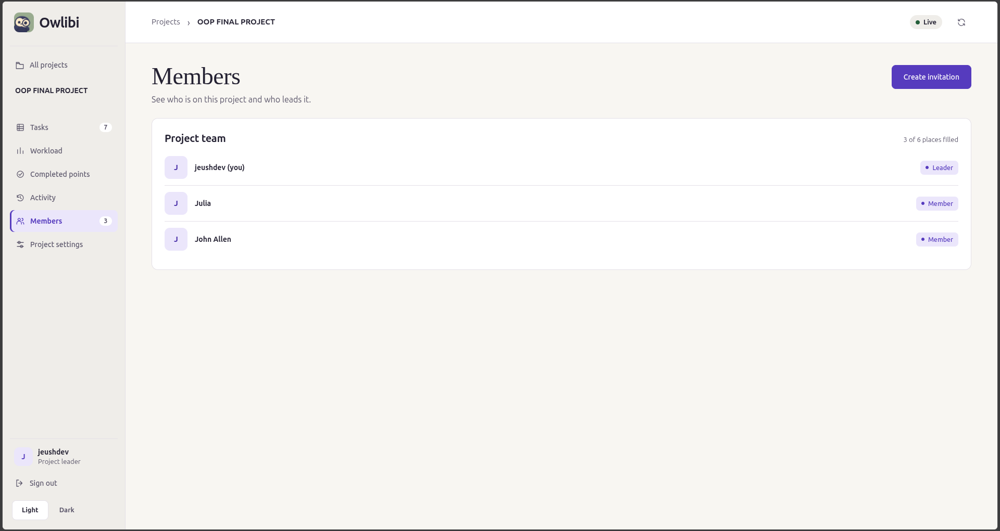

<p align="center">
  
</p>

<h1 align="center">𐔌 .⋮ Owlibi .ᐟ ₊ ꒱</h1>
<p align="center"><strong>A group-project alibi, one approved task at a time.</strong></p>
<p align="center">
  <strong>OOP 101 · CS2103</strong><br>
  3 of a Kind<br>
  John Allen P. Alvarez · Jeush Samuel L. Bantayaon · Julia M. Fernando
</p>

## ‧₊˚ ┊ Overview

When a professor asks who did what, the answer can be scattered across a group chat. Owlibi gives student teams a shared record of who agreed to each task, what was approved, and how the completed points were split.

```text
Accept the task → Start work → Submit for review → Leader approves → Points count
```

## ‧₊˚ ┊ Problem and Objectives

**The problem.** In most student group projects, tasks are handed out in a group chat. Nobody records who agreed to what, work gets called "done" without anyone checking it, and when the deadline comes the team argues over who contributed. The professor only sees the final output and has no fair way to tell the members' shares apart.

**Who it is for.** Student teams of two to six members, led by one project leader. The professor receives the exported report and does not need an account.

**Objectives.**
1. Record each task's agreement (who is assigned and how many effort points it is worth) before work starts.
2. Count only work that the leader has reviewed and approved.
3. Warn the team early about uneven workloads and approaching deadlines.
4. Give the professor a clear, exportable record of each member's completed work.

**Out of scope for this version.** Instructor accounts, grading integrations, offline editing, native mobile apps, and live push updates.

## ‧₊˚ ┊ Features

1. **Set up the project.** Start from scratch or use an editable template. Invite up to six people total, including the project leader.
2. **Agree before starting.** Add a task, assign one or more members, and set its effort points. Each assignee accepts the current agreement before work starts. If the effort points or assignees change, every current assignee must accept the revised agreement before the task can advance.
3. **Review before counting.** Assignees submit work for review. The project leader can approve the task or send it back for another pass.
4. **Check the workload.** See where open effort is concentrated and which deadlines are approaching. The activity history records changes such as task edits and approvals.
5. **Share the record.** Completed points are split equally among a task’s assignees. The leader can export an Excel professor report with a project summary, member contributions, task details, workload, activity history, and project rules.

> If two members share an approved 8-point task, each gets 4 completed points. The percentage on **Completed points** is that member’s share of the project’s approved effort points. The team supplies those estimates.

## ‧₊˚ ┊ Project Structure

```text
owlibi/
├── server-api/
│   └── src/main/
│       ├── java/          Spring Boot controllers, services, and reports
│       └── resources/     Configuration, SQL migrations, and project templates
├── web-client/
│   ├── src/               HTML, CSS, and JavaScript
│   └── scripts/           Browser asset build
├── hosting/               Render and Supabase setup
└── compose.yaml           Local PostgreSQL setup
```


## ‧₊˚ ┊ External Libraries and Tools

| Library or tool | Version | What Owlibi uses it for |
| --- | --- | --- |
| Java | 21 | Language and runtime for the server |
| Spring Boot (Web MVC, Security, JDBC) | 4.1.1 | REST API, sign-in sessions, CSRF protection, database access |
| PostgreSQL and its JDBC driver | 17 | Stores accounts, projects, tasks, and activity history |
| Flyway | Managed by Spring Boot | Versioned database migrations (`V1` to `V4`) |
| Jackson | 3.1.7 | Converts Java objects to and from JSON |
| Apache POI (`poi-ooxml`) | 5.5.1 | Builds the Excel professor report |
| Apache Commons IO | 2.21.0 | File helpers used while writing the report |
| Embedded Apache Tomcat | 11.0.26 | Web server inside the Spring Boot app |
| JUnit and Testcontainers | Managed by Spring Boot | Unit and integration tests against a real PostgreSQL |
| Node.js | 24 | Builds the browser files and runs the web unit tests (no npm packages) |
| Maven Wrapper, Docker, Render, Supabase | | Build, local database, and hosting |

## ‧₊˚ ┊ How to Run

Install Git, JDK 21+, Node.js 24+, and Docker with Compose. The repository includes the Maven Wrapper.

```bash
git clone https://github.com/jeushdev/owlibi.git
cd owlibi
cp .env.example .env
```

Set distinct values for `OWLIBI_ADMIN_PASSWORD`, `OWLIBI_MIGRATION_PASSWORD`, and `OWLIBI_RUNTIME_PASSWORD` in `.env` before starting PostgreSQL for the first time.

```bash
docker compose --env-file .env up -d db
node web-client/scripts/build.mjs
set -a
. ./.env
set +a
./mvnw -f server-api/pom.xml spring-boot:run -Dspring-boot.run.profiles=local
```

Open [Owlibi on localhost](http://127.0.0.1:8080/) using the default port. On Windows, load the `.env` values into PowerShell and use `.\mvnw.cmd` for the Maven command.

## ‧₊˚ ┊ Why Object-Oriented Programming

- **The problem is made of things with rules.** Projects, members, tasks, agreements, and reports each have their own data and their own rules. Objects let each concept keep its data and rules together instead of spreading checks across the whole program.
- **The rules must not be bypassed.** Because task changes are encapsulated in `TaskService`, the browser cannot skip review or approve its own work. Every request goes through the same checks.
- **Similar jobs share one skeleton.** Every move a task can make (start, submit, approve, return, reopen, cancel) has the same shape, so each one extends one abstract class, `TaskTransition`, and only differs in its answers. Security checks do the same with Spring's `OncePerRequestFilter`. That replaces long `switch` and `if` chains with inheritance and polymorphism.
- **Changes stay local.** The report layout, the project templates, and the database code each live behind their own class, so one can change without breaking the others.

## ‧₊˚ ┊ Class Diagram

A simplified view of the main classes. Arrows with hollow triangles show inheritance, dashed ones show an interface, and plain arrows show which class uses which.



## ‧₊˚ ┊ Object-Oriented Principles

### 💡 Abstraction

`TaskTransition` is an **abstract class** we wrote for the task workflow. It holds what every move between statuses has in common (an action name, the statuses it can start from, and the status it leads to) and declares three `abstract` methods that each move must answer: `openToAssignees()`, `requiresReason()`, and `requiresAcceptance()`. `TaskService` only works with the abstract type, so it never needs to know which of the six moves it is handling. [TaskTransition.java](server-api/src/main/java/dev/owlibi/reference/tasks/TaskTransition.java#L21-L64)

The same idea appears in two other places. Spring's `OncePerRequestFilter` is an abstract class whose `abstract doFilterInternal()` each security filter fills in. And `ReportController` calls `ReportWorkbook.generate()` and gets back a finished Excel file without knowing anything about Apache POI, sheet layouts, or column widths. [ReportController.java](server-api/src/main/java/dev/owlibi/reference/reports/ReportController.java#L48-L66) · [ReportWorkbook.java](server-api/src/main/java/dev/owlibi/reference/reports/ReportWorkbook.java#L306-L336)

### 💊 Encapsulation

`TaskService` keeps its collaborators in `private final` fields and the database shape of tasks and assignments in `private record`s (`Stored`, `Assigned`) that no other class can see. Other classes can change a task only through public methods such as `accept()` and `transition()`. `transition()` checks the caller's role, that the task is in the right status, and that every assignee accepted the current agreement, then saves the new status and its activity entry in one transaction. Because the rules live behind these methods, no controller can move a task to Done without passing them. [TaskService.java](server-api/src/main/java/dev/owlibi/reference/tasks/TaskService.java#L123-L147)

`TaskTransition` protects its own data the same way. Its fields are `private final`, and `next()` is `final`, so no subclass can change how the next status is worked out. Immutable `record`s such as [`Cursor`](server-api/src/main/java/dev/owlibi/reference/web/Cursor.java) and [`ApiError`](server-api/src/main/java/dev/owlibi/reference/web/ApiError.java) cannot change after they are created.

### 🧬 Inheritance

Six classes extend `TaskTransition`, one for each move a task can make:

```java
abstract sealed class TaskTransition Ellipsis
final class Start        extends TaskTransition  // To do → In progress   (assignees may request it)
final class SubmitReview extends TaskTransition  // In progress → Review  (assignees may request it)
final class Approve      extends TaskTransition  // Review → Done         (leader only)
final class Return       extends TaskTransition  // Review → In progress  (leader, reason required)
final class Reopen       extends TaskTransition  // Done → In progress    (leader, reason required)
final class Cancel       extends TaskTransition  // not Done → Cancelled  (leader, reason required)
```

Each subclass inherits the fields, the constructor logic, `next()`, and `firstStart()`, and supplies only its own answers. The parent is `sealed`, so these six are the only subclasses Java allows. [TaskTransition.java](server-api/src/main/java/dev/owlibi/reference/tasks/TaskTransition.java#L66-L137)

We also inherit from library classes where that is what they are designed for. `SessionBoundaryFilter`, `SessionEpochFilter`, and `HostedOriginFilter` extend Spring's `OncePerRequestFilter`, and [`ApiFailure`](server-api/src/main/java/dev/owlibi/reference/web/ApiFailure.java) extends `RuntimeException`, so a broken rule can be thrown like any Java exception while still carrying an HTTP status and an error code.

### 🎭 Polymorphism

**Method overriding.** In `TaskService.transition()`, the variable `move` has the type `TaskTransition`. When the service calls `move.openToAssignees()`, `move.requiresAcceptance()`, or `move.firstStart(...)`, Java runs the version from the actual object at runtime. `Approve` answers that assignees may not request it, while `Start` answers that they may. `Start` is also the only class that overrides `firstStart()`, recording when work on the task first began; the other five inherit the default, which leaves it unchanged. One method call, six different behaviors, and no `switch` on action names. [TaskService.java](server-api/src/main/java/dev/owlibi/reference/tasks/TaskService.java#L123-L147)

The security filters work the same way: Spring calls the same `doFilter()` on each one, and Java runs that filter's own `doFilterInternal()`. [SessionBoundaryFilter.java](server-api/src/main/java/dev/owlibi/reference/security/SessionBoundaryFilter.java#L15-L71) · [SessionEpochFilter.java](server-api/src/main/java/dev/owlibi/reference/security/SessionEpochFilter.java#L10-L24)

**Interfaces.** [`ReportWorkspace`](server-api/src/main/java/dev/owlibi/reference/reports/ReportWorkspace.java#L11) `implements AutoCloseable`, so `try (var workspace = new ReportWorkspace(...))` in `ReportController` deletes the report's temporary files automatically, exactly the way Java closes a file or a stream.

### 🏗️ Overall OOP Design

- **One package per feature.** `projects`, `tasks`, `summaries`, `reports`, and `security` each follow controller → service → SQL, so every class has one job.
- **Inheritance only for real "is-a" relationships.** Every `Approve` *is a* `TaskTransition`, so it extends one. Elsewhere we use composition: services receive what they need through their constructors (`TaskService` gets a database template, a `Clock`, and a `SnapshotService`), and injecting the `Clock` lets tests control time.
- **Open to extension.** A new kind of task move means one new `TaskTransition` subclass, without editing the checks in `TaskService`.
- **Data, not subclasses, where behavior is the same.** Project templates differ only in their data, so they live in `catalogue.json` instead of one class per template.
- **Separate shapes for separate layers.** API objects (`TaskDtos`, `SummaryDtos`), database rows (private records), and browser view models are kept apart, so changing one layer does not break the others.

## ‧₊˚ ┊ Example Output

**Tasks · The team’s working list**

The team used Owlibi to track its own OOP final project. The Tasks table shows what was assigned, who accepted, and what was due.


**Completed points · The approved work**

Three approved tasks add up to 12 completed points in this screenshot. The allocation table shows where the totals come from. The account shown as `jeushdev` has a 5-point task and a 2-point task, giving it 7 of 12 points (58.3%). The project leader can export the professor report from this view.


**Members · Who was on the project**

The roster shows the project leader, the members, and how many places are available.



## ‧₊˚ ┊ Contributors

<table>
  <tr>
    <th>Photo</th>
    <th>Team member</th>
    <th>Project role and area</th>
  </tr>
  <tr>
    <td></td>
    <td><strong>John Allen P. Alvarez</strong><br><a href="https://github.com/jhnllnlvrz">@jhnllnlvrz</a></td>
    <td>Member · Tasks, summaries, and Excel reports</td>
  </tr>
  <tr>
    <td></td>
    <td><strong>Jeush Samuel L. Bantayaon</strong><br><a href="https://github.com/jeushdev">@jeushdev</a></td>
    <td>Project leader · Repository setup, accounts, projects, and hosting</td>
  </tr>
  <tr>
    <td></td>
    <td><strong>Julia M. Fernando</strong><br><a href="https://github.com/molii-julia">@molii-julia</a></td>
    <td>Member · Browser client and frontend tests</td>
  </tr>
</table>

## ‧₊˚ ┊ Acknowledgment

Thank you to **Ms. Fatima Marie Agdon** for guiding us through OOP 101 and to our classmates for their feedback during the project.

---

**AI usage.** We first built an early version of Owlibi with AI tools (Codex and Claude Code), then used it as a reference while building this version ourselves. [docs/AI_USAGE.md](docs/AI_USAGE.md) lists the tools and each member's part of the project.
