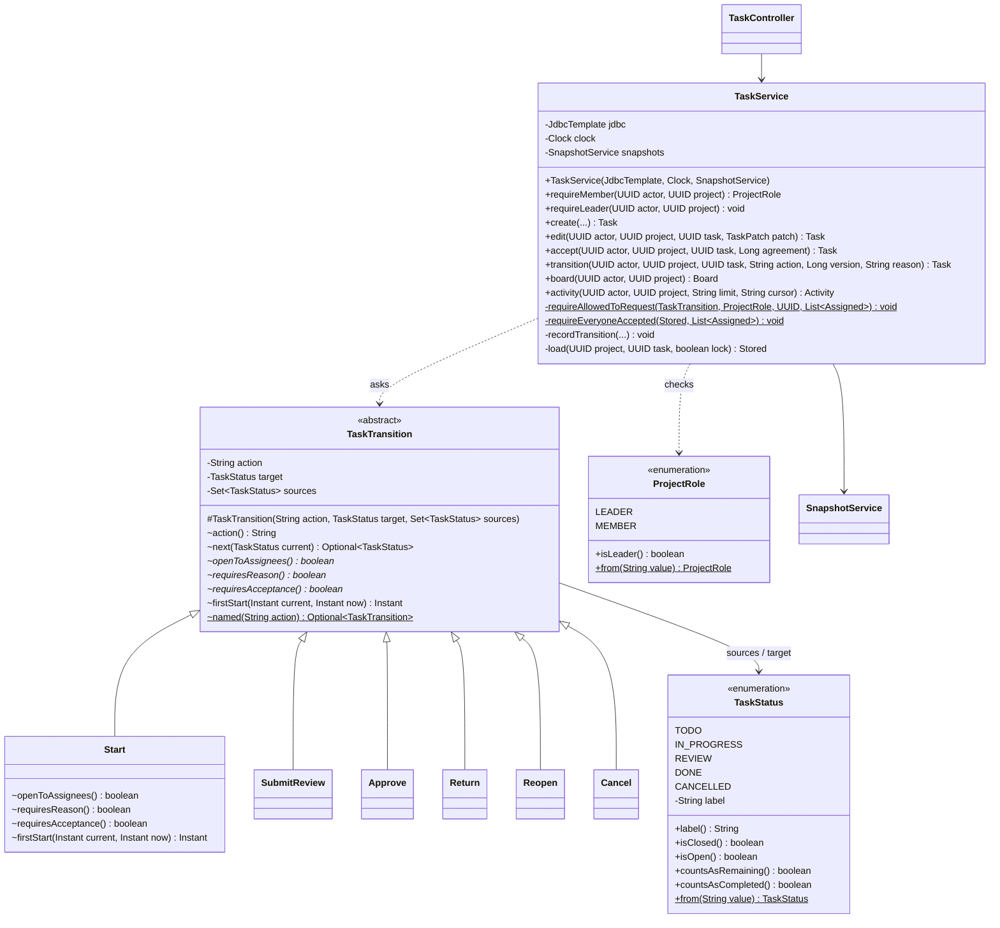
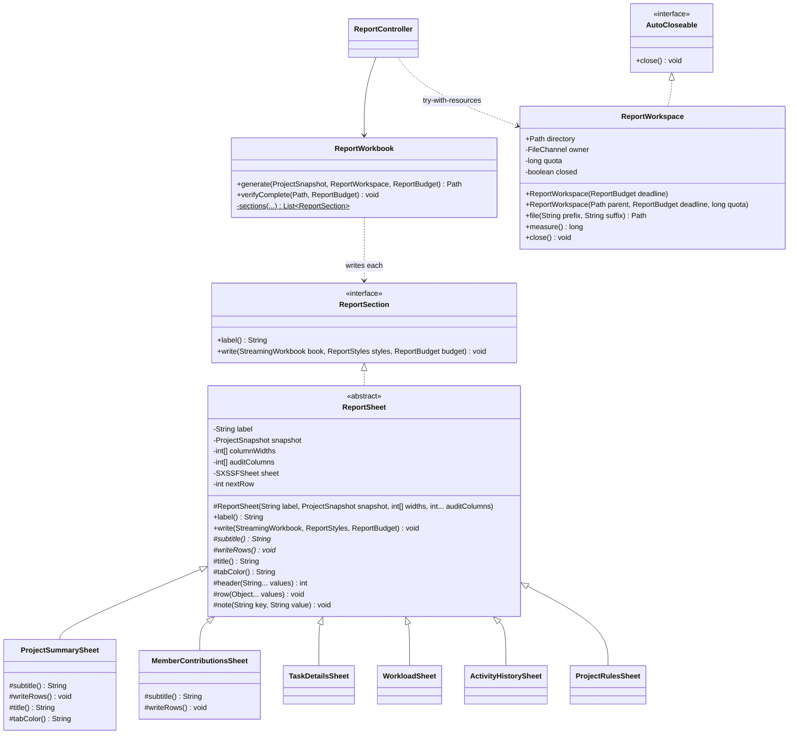
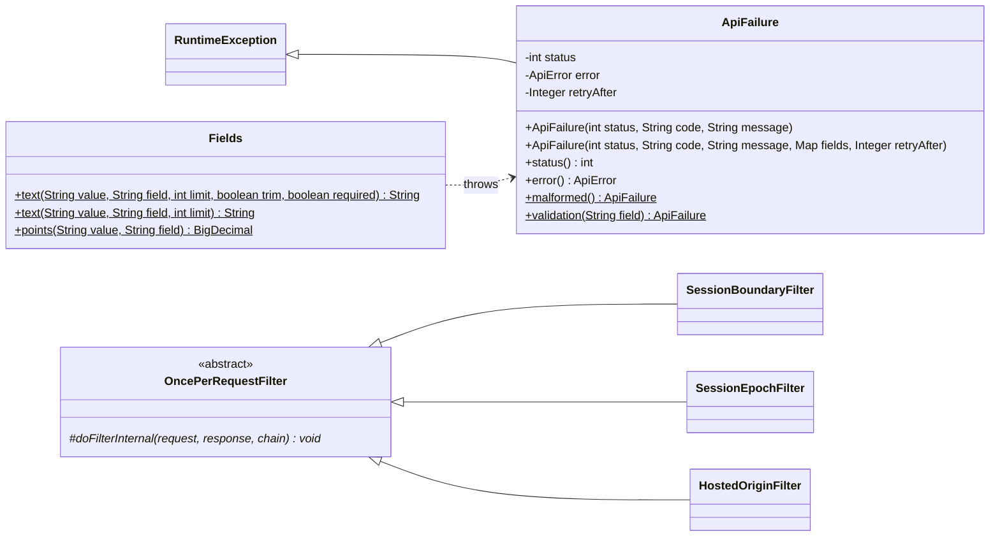

# Owlibi UML class diagrams

These diagrams cover the classes that carry the OOP design. Controllers, DTO records and configuration classes are left out to keep them readable. They are the source for Laboratory Activity 3. Redraw them in the tool and format the lab instructions ask for.

**Notation:** `+` public, `-` private, `#` protected, `~` package-private. A `*` after a method means abstract (italic in standard UML), and `$` means static (underlined in standard UML). Arrows:

- Hollow triangle, solid line: inheritance (`extends`).
- Hollow triangle, dashed line: an interface being implemented (`implements`).
- Solid arrow: a class keeps a reference to another (association).
- Dashed arrow: a class uses another only for a moment (dependency).

## 1. Task workflow

`SubmitReview`, `Approve`, `Return`, `Reopen` and `Cancel` override the same three abstract methods as `Start`. Only `Start` also overrides `firstStart()`.

## 2. Professor report

`ReportSheet` is declared `abstract sealed ... permits` the six sheets. `write()` is `final`: it is the Template Method that calls the abstract `subtitle()` and `writeRows()` hooks.

## 3. Errors and validation

`ApiFailure` has two constructors, and `Fields` has two `text(...)` methods. Both are examples of method overloading.
